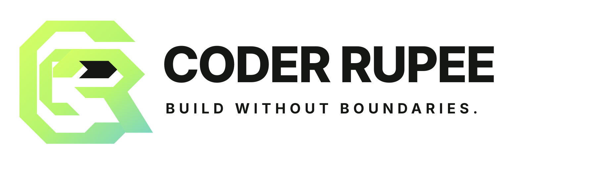

<p align="center">
  
</p>

<h1 align="center">CoderRupee</h1>

<p align="center">
  The AI coding agent that lives in your terminal and desktop.<br/>
  <em>Build without boundaries.</em>
</p>

<p align="center">
  <a href="https://github.com/nareinnprs-create/coderrupee/releases/latest"></a>
  <a href="https://github.com/nareinnprs-create/coderrupee/actions/workflows/test.yml"></a>
  <a href="LICENSE"></a>
</p>

---

## What is CoderRupee?

CoderRupee is an AI-powered coding agent for the terminal and desktop, built by
**Opraiz Technology Pvt Ltd** (R&D by opraizfoundry). It plans, writes, reviews, and
ships code with you — across your choice of 75+ models and providers, with durable
sessions, permission-gated tools, and cost control built in.

## Features

- **Terminal UI & desktop app** — the same agent, in the terminal (TUI) or a native
  desktop app for Windows, macOS (Intel + Apple Silicon), and Linux
- **75+ models, one interface** — Anthropic, OpenAI, Google, Bedrock, Azure, xAI,
  GitLab, OpenRouter, NVIDIA, Cloudflare AI Gateway, and more; bring your own API keys
  or use gateway endpoints
- **Agent tools that ship** — file edit with fuzzy matching and formatter integration,
  shell with parser-based approvals, background jobs, web fetch/search, LSP diagnostics,
  multi-file patches
- **Subagents** — built-in specialists (reviewer, tester, security, documenter,
  migrator, deployer, profiler) with scoped permissions
- **Cost budgets** — per-session budgets with warn thresholds, enforced in the loop
- **Guarded checkpoints & rollback** — safe restore points, update channels with
  `coderrupee upgrade --rollback`
- **`coderrupee doctor`** — one command to diagnose installation, keyring, auth, config,
  and storage
- **OS keyring** — provider credentials in the system keychain, plaintext opt-out
- **MCP** — Model Context Protocol servers for extended tooling
- **Desktop extras** — system tray, native notifications, deep links, auto-update feed

## Install

```bash
curl -fsSL https://coderrupee.opraiz.com/install | bash
```

Or with npm:

```bash
npm install -g coderrupee-ai
```

Windows, macOS (Intel & Apple Silicon), and Linux desktop installers are available on
the [releases page](https://github.com/nareinnprs-create/coderrupee/releases/latest).

## Quick start

```bash
coderrupee            # start the TUI in your project
coderrupee run "fix the failing tests in src/auth"   # one-shot task
coderrupee doctor     # verify your installation
```

## Documentation

- [Docs](https://coderrupee.opraiz.com/docs)
- [Changelog](https://coderrupee.opraiz.com/changelog.json)
- [Config schema](https://coderrupee.opraiz.com/config.json)

## Update channels

CoderRupee checks GitHub releases for updates and can roll back:

```bash
coderrupee upgrade            # update to the latest version
coderrupee upgrade --rollback # roll back to the previous version
```

## License

This product is commercially licensed. See the [LICENSE](LICENSE) file for details.

## Copyright

(c) 2026 Opraiz Technology Pvt Ltd. All rights reserved.
Developer: Narein Rao — R&D by opraizfoundry
